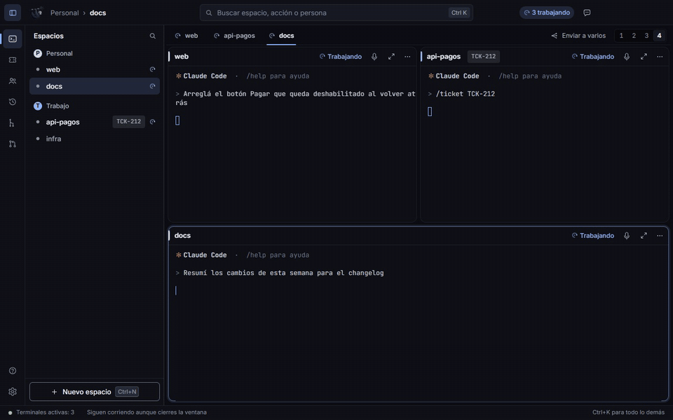
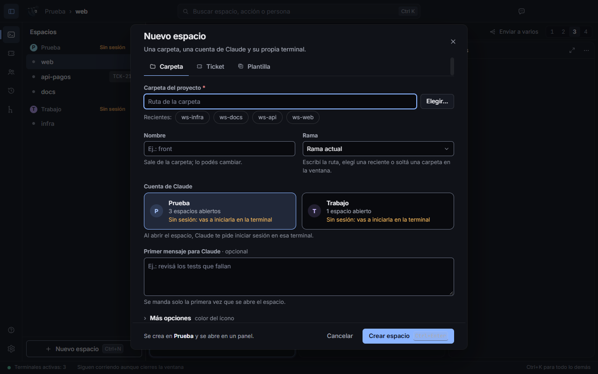
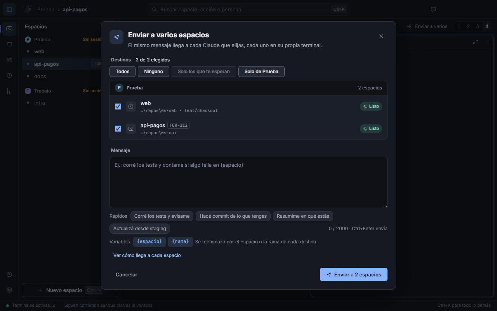
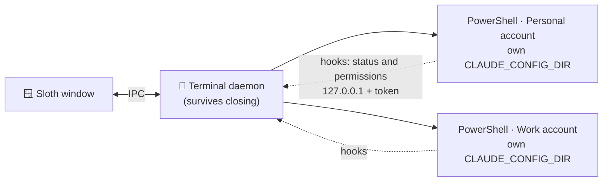

<p align="right"><a href="README.md">🇦🇷 Español</a></p>

<p align="center">
  
</p>

<p align="center">
  <a href="https://github.com/Toomasmg/sloth/releases/latest"></a>
  
  
  
</p>

<h3 align="center">Run several Claude Code sessions, each with its own account and repo,<br>and see at a glance which one needs you.</h3>

<p align="center">
  <a href="https://github.com/Toomasmg/sloth/releases/latest"></a>
</p>

<p align="center">
  <a href="#problem">🤔 Why</a> ·
  <a href="#features">✨ Features</a> ·
  <a href="#install">⬇️ Install</a> ·
  <a href="#getting-started">🚀 Getting started</a> ·
  <a href="#internals">⚙️ Internals</a> ·
  <a href="#lightweight">🪶 Lightweight</a> ·
  <a href="#development">🛠️ Development</a>
</p>

<p align="center">
  
</p>
<p align="center"><sub>Recorded with the real app and sample data (the app's interface is in Spanish): <code>npm run readme:demo</code> records it again.</sub></p>

<p align="center"></p>

<a id="problem"></a>

## 🤔 What problem it solves

Claude Code uses a single config folder per user, which means **one account at a time**. If you have a personal account and a work one, or want several agents on different repos, you end up logging out, opening loose terminals and never knowing which one is waiting for you.

<table>
<tr>
<th width="50%">😩 Without Sloth</th>
<th width="50%">🦥 With Sloth</th>
</tr>
<tr>
<td>

- Log out to switch accounts.
- Five loose, unnamed terminals.
- Check them one by one to see which finished.
- A pending permission blocks everything and you don't notice.

</td>
<td>

- Every account keeps its own login, always ready.
- Every task lives in a **space**: folder, account and terminal.
- Live status: **Working**, **Needs you**, **Done**.
- Permissions show up as a card: approve in one click.

</td>
</tr>
</table>

<p align="center"></p>

<a id="features"></a>

## ✨ Features

<table>
<tr>
<td width="33%" valign="top">

### 👥 Separate accounts
Each account has its own login and history. A terminal never uses the wrong account by accident.

</td>
<td width="33%" valign="top">

### 🧩 Spaces in a grid
Several Claude sessions in view, each with its account color, folder and status.

</td>
<td width="33%" valign="top">

### 🚦 Live status
Ready, Working, Needs you, Done or Closed. You know where to go back without checking each one.

</td>
</tr>
<tr>
<td valign="top">

### 🛡️ Permissions in the app
When Claude asks for permission, a card shows up: Approve, Always approve, Deny or Answer in the terminal.

</td>
<td valign="top">

### ♾️ Terminals that stay alive
Close the window and the agents keep working. Reopen it and everything reconnects with its full history.

</td>
<td valign="top">

### 📊 Usage per account
Tokens for the last 5 h, today and 7 days. When you create a space, Sloth suggests the account you've used least.

</td>
</tr>
<tr>
<td valign="top">

### 📣 Send to many
The same message to every Claude you pick, each in its own terminal.

</td>
<td valign="top">

### 🎫 Tickets and templates
A space from a ticket (`PROJ-123`) or from a template with account, branch and first message.

</td>
<td valign="top">

### 🌿 Separate branches
`git worktree` for your repos, so two agents never step on each other in the same folder.

</td>
</tr>
<tr>
<td valign="top">

### 🔀 Git without leaving
Changes, commits, branches and PRs with `gh`. Nothing runs on its own: everything on demand.

</td>
<td valign="top">

### 🎙️ Voice dictation
Whisper on your PC: works offline and the audio never leaves your computer.

</td>
<td valign="top">

### ⌨️ Palette (`Ctrl+K`)
Find a space, an action or a teammate from the keyboard.

</td>
</tr>
</table>

<details>
<summary><b>More features</b></summary>

- **Resume**: reopening a space uses `claude --continue` if there was already a conversation in that folder.
- **Move a space to another account**: the conversation is copied to the target account and Claude picks up where it left off. Always manual.
- **Put idle spaces to sleep**: closes the Claude of an unused space to free memory and resumes it when you wake it up. Only when it's safe: no pending permissions and no unsent text.
- **History**: each account's conversations, read from its transcripts.
- **Team and chat**: what everyone is working on (GitHub via `gh`, read-only) and a team chat on your own Supabase project. See [`docs/chat-equipo.md`](docs/chat-equipo.md) and [`docs/team-config.md`](docs/team-config.md) (in Spanish).
- **Move your setup to another PC**: a `.sloth` file, with an optional password. It never includes tokens, credentials or sessions.
- **Updates**: from this repo's releases. Nothing downloads on its own and updating doesn't kill the terminals.
- **Privacy**: what Sloth stores, what leaves your PC and how to delete it, in [`PRIVACY.md`](PRIVACY.md) (in Spanish).

</details>

<table>
<tr>
<td width="50%"></td>
<td width="50%"></td>
</tr>
<tr>
<td align="center"><b>New space</b>: folder, account and first message.</td>
<td align="center"><b>Send to many</b>: one message, several Claude sessions.</td>
</tr>
</table>

<p align="center"></p>

<a id="install"></a>

## ⬇️ Install

You need **Windows x64** and [Claude Code](https://docs.claude.com/en/docs/claude-code) installed.

**With the installer.** Download `Sloth-Setup-<version>.exe` from [Releases](https://github.com/Toomasmg/sloth/releases/latest). After that it updates from inside the app.

**From source.** With Node 22.18 or newer:

```powershell
npm install
npm run dev               # development with reload
npm run build; npm start  # compiled build
npm run dist              # .exe installer in dist/
```

<a id="getting-started"></a>

## 🚀 Getting started

1. **Add an account.** Type a name and add it: Claude opens with that account so you can log in. For the second account use an incognito browser window, so it doesn't reuse the first one's session.
2. **Create a space** with "Nuevo espacio" (`Ctrl+N`): folder, account, branch and, optionally, the first message for Claude. It also works from a ticket: with a connector that uses the `/ticket` skill, Claude opens with `/ticket PROJ-123`.
3. **Open several.** They show up in a grid. Everything else is in the palette, with `Ctrl+K`.

| Shortcut | What it does |
|---|---|
| `Ctrl+K` | Palette: spaces, actions and people |
| `Ctrl+N` | New space |
| `Ctrl+Shift+D` | Start or stop dictation |
| `Ctrl+Shift+C` / `Ctrl+Shift+V` | Copy and paste in the terminal |
| Right click | Copies the selection or pastes |

<p align="center"></p>

<a id="internals"></a>

## ⚙️ How it works



<details>
<summary><b>Accounts</b>: one folder per account</summary>

- Each account is its own folder used as `CLAUDE_CONFIG_DIR` (`%APPDATA%\Sloth\accounts\<id>\claude`). Login and history stay separate.
- **Shared setup** (one switch per account, on by default): `skills`, `agents`, `commands`, `hooks`, `plugins` and `output-styles` from `~/.claude` are linked with junctions, so whatever you change shows up instantly in every account. `settings.json`, `CLAUDE.md` and the statusline are copied on every start, and the MCPs from `~/.claude.json` are added to the account.
- Heads up: in an account with shared setup, settings changed from that account are overwritten on reopen. Edit `~/.claude` instead.
- **Clean environment**: every terminal starts without `ANTHROPIC_API_KEY` or variables from another Claude session. If the account is missing, the terminal doesn't start.

</details>

<details>
<summary><b>Daemon</b>: terminals live apart from the window</summary>

- The PowerShells run in a daemon (`node`, ~56 MB, 0 % CPU at rest) separate from the window. That's why closing Sloth doesn't stop the agents.
- The daemon shuts down on its own after 30 s with no terminals or windows left.
- If there's no `node` in the PATH, terminals run inside the app ("simple mode").
- From the title bar: "Shut down all terminals".

</details>

<details>
<summary><b>Hooks</b>: status and permissions</summary>

- Live status comes from Claude Code hooks that only report inside Sloth, with a per-session token, to `127.0.0.1`.
- Permissions use the `PermissionRequest` hook. If you don't answer within 2 minutes or the app is closed, Claude asks in the terminal as usual.
- Usage per account is read from each account's transcripts.

</details>

<a id="lightweight"></a>

## 🪶 Lightweight by design

Sloth sits next to agents that already use their share. It shouldn't compete with them for the machine.

<table>
<tr>
<td align="center" width="25%"><h3>~56 MB</h3><sub>terminal daemon,<br>0 % CPU at rest</sub></td>
<td align="center" width="25%"><h3>16 ms</h3><sub>batched terminal output,<br>no polling</sub></td>
<td align="center" width="25%"><h3>1 MB</h3><sub>chunks to read transcripts<br>hundreds of MB large</sub></td>
<td align="center" width="25%"><h3>~109 MB</h3><sub>installer: Spanish, English<br>and Windows x64 only</sub></td>
</tr>
</table>

- No background workers, telemetry, embedded browser or plugins: just the window and the daemon.
- Chromium without spare renderer, media, translation, autofill or spellchecker.
- **Automatic light mode**: on PCs with 8 GB of RAM or less the GPU is turned off (≈ 90 MB less). Force it with `SLOTH_GPU=1` (on) or `SLOTH_GPU=0` (off).

<p align="center"></p>

<a id="development"></a>

## 🛠️ Development

Electron, React and TypeScript.

| Command | What it does |
|---|---|
| `npm run dev` | Development with reload |
| `npm run typecheck` | `tsc` without emitting |
| `npm test` | Unit tests for the pure modules with `node --test` (Node ≥ 22.18) |
| `npm run build` | electron-vite plus the daemon |
| `npm run test:e2e` | Build plus the visual tests with Playwright |
| `npm run fetch-whisper` | Downloads the dictation model to `vendor/whisper` (190 MB, hash-verified) for dev and e2e; the build doesn't fetch it and the installer doesn't ship it |
| `npm run dist` | `.exe` installer in `dist/` |
| `npm run readme:demo` | Records `docs/img/demo.gif` again with the real app and sample data (needs `ffmpeg` in the PATH or in `FFMPEG`) |

For a test instance next to the installed one, without touching your data: `SLOTH_USER_DATA=<folder> npm run dev`.

## 🤝 Contributing

- Branches come from `origin/staging` and PRs go to `staging`. Nobody works on `main`.
- Before the PR, rebase on `origin/staging`. CI runs typecheck, test and build.
- UI text, comments and commits are in Rioplatense Spanish.
- If a visual test changes, explain why: `test:e2e:update` is never used just to make a test pass.
- Code style and project rules live in [`CLAUDE.md`](CLAUDE.md).

<p align="center"></p>

<p align="center"><br><sub>Made with 🦥 for people who have more than one Claude open.</sub></p>
