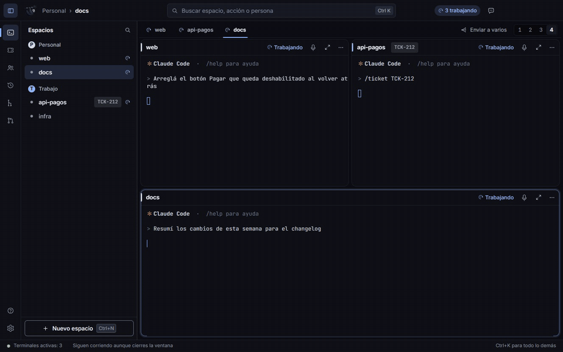
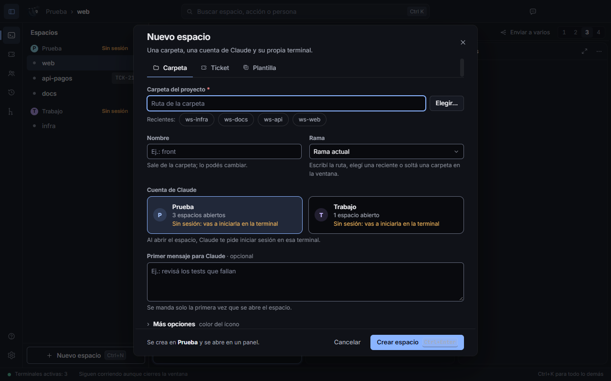
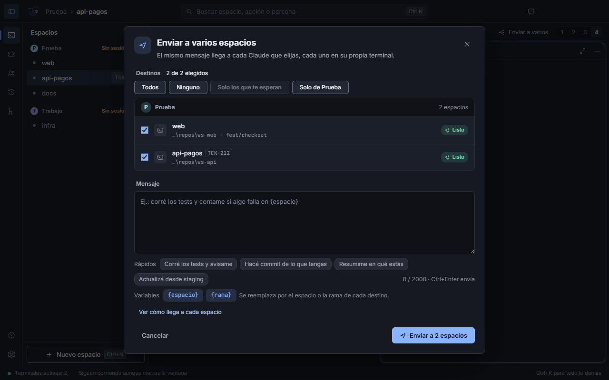
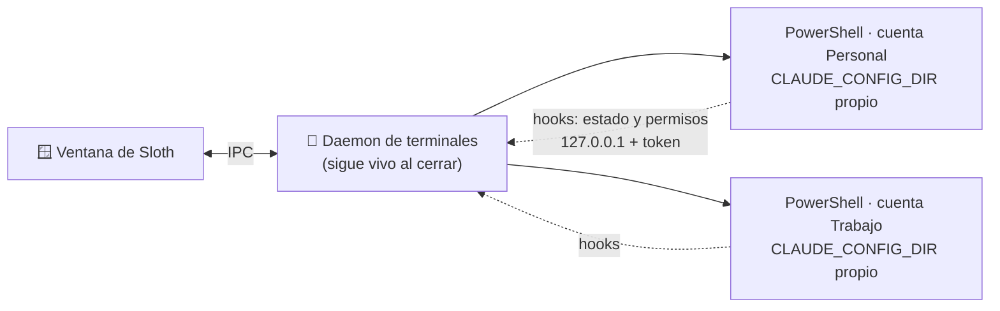

<p align="right"><a href="README.en.md">🇬🇧 English</a></p>

<p align="center">
  
</p>

<p align="center">
  <a href="https://github.com/Toomasmg/sloth/releases/latest"></a>
  
  
  
</p>

<h3 align="center">Abrí varios Claude Code, cada uno con su cuenta y su repo,<br>y enterate al toque de cuál te necesita.</h3>

<p align="center">
  <a href="https://github.com/Toomasmg/sloth/releases/latest"></a>
</p>

<p align="center">
  <a href="#problema">🤔 Qué resuelve</a> ·
  <a href="#funciones">✨ Qué hace</a> ·
  <a href="#instalar">⬇️ Instalar</a> ·
  <a href="#primeros-pasos">🚀 Primeros pasos</a> ·
  <a href="#por-dentro">⚙️ Por dentro</a> ·
  <a href="#liviano">🪶 Liviano</a> ·
  <a href="#desarrollo">🛠️ Desarrollo</a>
</p>

<p align="center">
  
</p>
<p align="center"><sub>Demo grabada con la app real y datos de ejemplo: <code>npm run readme:demo</code> la vuelve a grabar.</sub></p>

<p align="center"></p>

<a id="problema"></a>

## 🤔 Qué problema resuelve

Claude Code usa una sola carpeta de configuración por usuario, o sea **una cuenta por vez**. Si tenés una cuenta personal y otra del trabajo, o querés varios agentes en repos distintos, terminás cerrando sesión, abriendo terminales sueltas y sin saber cuál te está esperando.

<table>
<tr>
<th width="50%">😩 Sin Sloth</th>
<th width="50%">🦥 Con Sloth</th>
</tr>
<tr>
<td>

- Cerrás sesión para cambiar de cuenta.
- Cinco terminales sueltas, sin nombre.
- Revisás una por una a ver cuál terminó.
- Un permiso pendiente frena todo y no te enterás.

</td>
<td>

- Cada cuenta con su login, siempre lista.
- Cada tarea en un **espacio**: carpeta, cuenta y terminal.
- Estado en vivo: **Trabajando**, **Te necesita**, **Terminó**.
- El permiso aparece en una tarjeta: lo aprobás en un clic.

</td>
</tr>
</table>

<p align="center"></p>

<a id="funciones"></a>

## ✨ Qué hace

<table>
<tr>
<td width="33%" valign="top">

### 👥 Cuentas separadas
Cada cuenta tiene su login y su historial. Una terminal nunca usa otra cuenta por accidente.

</td>
<td width="33%" valign="top">

### 🧩 Espacios en grilla
Varios Claude a la vista, cada uno con el color de su cuenta, su carpeta y su estado.

</td>
<td width="33%" valign="top">

### 🚦 Estado en vivo
Listo, Trabajando, Te necesita, Terminó o Cerrado. Sabés a cuál volver sin revisar una por una.

</td>
</tr>
<tr>
<td valign="top">

### 🛡️ Permisos desde la app
Cuando Claude pide permiso, aparece una tarjeta: Aprobar, Aprobar siempre, Rechazar o Responder en la terminal.

</td>
<td valign="top">

### ♾️ Terminales que siguen vivas
Cerrás la ventana y los agentes siguen trabajando. Al reabrir, se reconecta con todo el historial.

</td>
<td valign="top">

### 📊 Uso por cuenta
Tokens de las últimas 5 h, de hoy y de 7 días. Al crear un espacio, Sloth sugiere la cuenta que menos usaste.

</td>
</tr>
<tr>
<td valign="top">

### 📣 Enviar a varios
El mismo mensaje a cada Claude que elijas, cada uno en su terminal.

</td>
<td valign="top">

### 🎫 Tickets y plantillas
Un espacio a partir de un ticket (`PROJ-123`) o de una plantilla con cuenta, rama y primer mensaje.

</td>
<td valign="top">

### 🌿 Ramas aparte
Los `git worktree` de tus repos, para que dos agentes no se pisen en la misma carpeta.

</td>
</tr>
<tr>
<td valign="top">

### 🔀 Git sin salir
Cambios, commit, ramas y PR con `gh`. Nada corre solo: todo a pedido.

</td>
<td valign="top">

### 🎙️ Dictado por voz
Whisper en tu PC: funciona sin internet y el audio no sale de tu computadora.

</td>
<td valign="top">

### ⌨️ Paleta (`Ctrl+K`)
Buscar un espacio, una acción o una persona desde el teclado.

</td>
</tr>
</table>

<details>
<summary><b>Más funciones</b></summary>

- **Retomar**: al reabrir un espacio se usa `claude --continue` si ya hubo una conversación en esa carpeta.
- **Mover un espacio a otra cuenta**: la conversación se copia a la cuenta destino y Claude sigue donde estaba. Es siempre manual.
- **Dormir espacios inactivos**: cierra el Claude de un espacio sin uso para liberar memoria y lo retoma al despertarlo. Solo si es seguro: sin permisos esperando ni texto sin enviar.
- **Historial**: las conversaciones de cada cuenta, leídas de sus transcripts.
- **Equipo y chat**: en qué anda cada uno (GitHub con `gh`, solo lectura) y chat de equipo con tu propio proyecto de Supabase. Ver [`docs/chat-equipo.md`](docs/chat-equipo.md) y [`docs/team-config.md`](docs/team-config.md).
- **Llevar la configuración a otra PC**: un archivo `.sloth`, con contraseña opcional. Nunca incluye tokens, credenciales ni sesiones.
- **Actualizaciones**: desde los releases de este repo. Nada se descarga solo y actualizar no corta las terminales.
- **Privacidad**: qué guarda Sloth, qué sale de tu PC y cómo borrarlo, en [`PRIVACY.md`](PRIVACY.md).

</details>

<table>
<tr>
<td width="50%"></td>
<td width="50%"></td>
</tr>
<tr>
<td align="center"><b>Nuevo espacio</b>: carpeta, cuenta y primer mensaje.</td>
<td align="center"><b>Enviar a varios</b>: un mensaje, varios Claude.</td>
</tr>
</table>

<p align="center"></p>

<a id="instalar"></a>

## ⬇️ Instalación

Necesitás **Windows x64** y [Claude Code](https://docs.claude.com/en/docs/claude-code) instalado.

**Con el instalador.** Bajá `Sloth-Setup-<versión>.exe` desde [Releases](https://github.com/Toomasmg/sloth/releases/latest). Después se actualiza desde la propia app.

**Desde el código.** Con Node 22.18 o más nuevo:

```powershell
npm install
npm run dev               # desarrollo con recarga
npm run build; npm start  # versión compilada
npm run dist              # instalador .exe en dist/
```

<a id="primeros-pasos"></a>

## 🚀 Primeros pasos

1. **Agregá una cuenta.** Escribí un nombre y agregala: se abre Claude con esa cuenta para iniciar sesión. Para la segunda cuenta usá una ventana de incógnito en el navegador, así no reusa la sesión de la primera.
2. **Creá un espacio** con «Nuevo espacio» (`Ctrl+N`): carpeta, cuenta, rama y, si querés, el primer mensaje para Claude. También desde un ticket: con un conector que use la skill `/ticket`, como Gruv, abre Claude con `/ticket PROJ-123`.
3. **Abrí varios.** Se ven en grilla. El resto está en la paleta, con `Ctrl+K`.

| Atajo | Qué hace |
|---|---|
| `Ctrl+K` | Paleta: espacios, acciones y personas |
| `Ctrl+N` | Nuevo espacio |
| `Ctrl+Shift+D` | Empezar o cortar el dictado |
| `Ctrl+Shift+C` / `Ctrl+Shift+V` | Copiar y pegar en la terminal |
| Clic derecho | Copia la selección o pega |

<p align="center"></p>

<a id="por-dentro"></a>

## ⚙️ Cómo funciona por dentro



<details>
<summary><b>Cuentas</b>: una carpeta por cuenta</summary>

- Cada cuenta es una carpeta propia usada como `CLAUDE_CONFIG_DIR` (`%APPDATA%\Sloth\accounts\<id>\claude`). El login y el historial quedan separados.
- **Tu setup compartido** (un switch por cuenta, activado por defecto): `skills`, `agents`, `commands`, `hooks`, `plugins` y `output-styles` de `~/.claude` se enlazan con junctions, así lo que cambies se ve al instante en todas las cuentas. `settings.json`, `CLAUDE.md` y la statusline se copian en cada arranque, y los MCP de `~/.claude.json` se agregan a la cuenta.
- Ojo: en una cuenta con setup compartido, los cambios de settings hechos desde esa cuenta se pisan al reabrir. Editá `~/.claude`.
- **Entorno limpio**: cada terminal arranca sin `ANTHROPIC_API_KEY` ni variables de otra sesión de Claude. Si la cuenta falta, la terminal no arranca.

</details>

<details>
<summary><b>Daemon</b>: las terminales viven aparte de la ventana</summary>

- Las PowerShell corren en un daemon (`node`, ~56 MB, 0 % de CPU en reposo) separado de la ventana. Por eso cerrar Sloth no corta a los agentes.
- El daemon se apaga solo a los 30 s si no quedan terminales ni ventanas.
- Si no hay `node` en el PATH, las terminales corren dentro de la app («Modo simple»).
- Desde la barra de título: «Apagar todas las terminales».

</details>

<details>
<summary><b>Hooks</b>: estado y permisos</summary>

- El estado en vivo llega por hooks de Claude Code que solo reportan dentro de Sloth, con un token por sesión, a `127.0.0.1`.
- Los permisos usan el hook `PermissionRequest`. Si no respondés en 2 minutos o la app está cerrada, Claude pregunta en la terminal como siempre.
- El uso por cuenta se lee de los transcripts de cada cuenta.

</details>

<a id="liviano"></a>

## 🪶 Liviano a propósito

Sloth acompaña a agentes que ya consumen lo suyo. No tiene que competir con ellos por la máquina.

<table>
<tr>
<td align="center" width="25%"><h3>~56 MB</h3><sub>el daemon de terminales,<br>0 % de CPU en reposo</sub></td>
<td align="center" width="25%"><h3>16 ms</h3><sub>salida de las terminales<br>agrupada, sin polling</sub></td>
<td align="center" width="25%"><h3>1 MB</h3><sub>bloques para leer transcripts<br>de cientos de MB</sub></td>
<td align="center" width="25%"><h3>~109 MB</h3><sub>instalador: solo español,<br>inglés y Windows x64</sub></td>
</tr>
</table>

- Sin workers de fondo, telemetría, navegador embebido ni plugins: solo ventana y daemon.
- Chromium sin renderer de repuesto, media, traducción, autocompletado ni corrector ortográfico.
- **Modo liviano automático**: en PCs con 8 GB de RAM o menos se apaga la GPU (≈ 90 MB menos). Se fuerza con `SLOTH_GPU=1` (encendida) o `SLOTH_GPU=0` (apagada).

<p align="center"></p>

<a id="desarrollo"></a>

## 🛠️ Desarrollo

Electron, React y TypeScript.

| Comando | Qué hace |
|---|---|
| `npm run dev` | Desarrollo con recarga |
| `npm run typecheck` | `tsc` sin emitir |
| `npm test` | Tests unitarios de los módulos puros con `node --test` (Node ≥ 22.18) |
| `npm run build` | electron-vite más el daemon |
| `npm run test:e2e` | Build más las pruebas visuales con Playwright |
| `npm run fetch-whisper` | Baja a `vendor/whisper` el modelo de dictado (190 MB, verificado por hash) para dev y e2e; el build no lo baja y el instalador no lo lleva |
| `npm run dist` | Instalador `.exe` en `dist/` |
| `npm run readme:demo` | Vuelve a grabar `docs/img/demo.gif` con la app real y datos de ejemplo (necesita `ffmpeg` en el PATH o en `FFMPEG`) |

Para una instancia de prueba al lado de la instalada, sin tocar tus datos: `SLOTH_USER_DATA=<carpeta> npm run dev`.

<details>
<summary>Estructura del código</summary>

| Carpeta | Qué hay |
|---|---|
| `src/main/` | Proceso main: ventana, cuentas y espacios (`store.ts`), terminales (`ptys.ts`, `daemon-client.ts`) |
| `src/main/features/` | El lado main de cada función. Se suman en `features/index.ts` |
| `src/renderer/src/features/` | La parte visual de cada función. Se suman en `features/registry.ts` |
| `src/shared/` | Tipos y lógica que usan main y renderer |
| `src/daemon/` | El daemon de terminales |
| `src/preload/` | El puente entre main y la interfaz |
| `e2e/` | Pruebas visuales con Playwright sobre el build |
| `scripts/readme/` | La demo y los SVG animados de este README |

</details>

## 🤝 Contribuir

- Las ramas salen de `origin/staging` y el PR va a `staging`. Nunca se trabaja sobre `main`.
- Antes del PR, rebase sobre `origin/staging`. La CI corre typecheck, test y build.
- Textos de la interfaz, comentarios y commits en español rioplatense, con voseo.
- Si una prueba visual cambia, explicá por qué: no se usa `test:e2e:update` para que un test pase.
- El estilo de código y las reglas del proyecto están en [`CLAUDE.md`](CLAUDE.md).

<p align="center"></p>

<p align="center"><br><sub>Hecho con 🦥 para los que tienen más de un Claude abierto.</sub></p>
